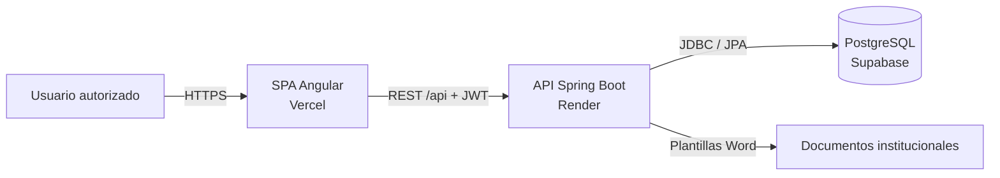
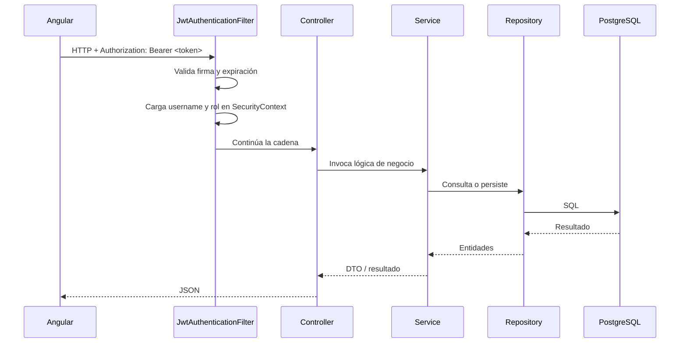

# Arquitectura del sistema

## 1. Visión general

El sistema sigue una arquitectura **monolítica desacoplada**: el frontend y el backend se desarrollan, despliegan y escalan de forma independiente, pero el backend concentra toda la lógica de negocio en una única aplicación Spring Boot.



### Principios de diseño

- **Separación de responsabilidades:** Angular gestiona la interfaz y el estado de sesión; Spring Boot expone la API, aplica reglas de negocio y controla el acceso.
- **API stateless:** cada petición autenticada transporta un JWT; el backend no mantiene sesiones HTTP.
- **Única puerta de entrada a datos:** el frontend nunca accede directamente a PostgreSQL; toda lectura y escritura pasa por la API.
- **Registro cerrado:** los usuarios se crean manualmente en la base de datos. No existe módulo público de registro.
- **Monolito modular:** el backend se organiza por capas y dominios, sin microservicios.

## 2. Frontend Angular

Ubicación: `frontend/`

La aplicación utiliza Angular 17 con una combinación de componentes standalone y módulos de funcionalidad.

```text
frontend/src/app/
├── core/
│   ├── guards/         Protección de rutas
│   ├── interceptors/   Inyección del JWT y manejo de 401
│   ├── models/         Contratos de datos
│   └── services/       Clientes HTTP por dominio
├── features/           Módulos funcionales
│   ├── auth/           Login
│   ├── dashboard/
│   ├── gestion-proyectos/
│   ├── calendario-defensas/
│   ├── directorio-docentes/
│   ├── jurados-sugeridos/
│   ├── reportes/
│   ├── documentos/
│   └── usuarios/
├── layouts/            Sidebar y navbar
├── shared/             Componentes reutilizables
├── app-routing.module.ts
├── app.module.ts
└── app.component.ts
```

### Características relevantes

- **Carga diferida:** cada módulo funcional se carga mediante `loadChildren` o `loadComponent`.
- **Rutas protegidas:** `AuthGuard` exige sesión válida; `guestGuard` impide que un usuario autenticado vuelva al login.
- **Ruta raíz condicional:** `/` redirige a `/dashboard` si hay token y a `/login` si no lo hay.
- **Interceptor funcional:** `authInterceptor` añade `Authorization: Bearer <token>` y cierra sesión ante respuestas `401`.
- **Servicios por dominio:** `AuthService`, `ProyectoService`, `DefensaService`, `DashboardService`, etc., centralizan el acceso a la API.
- **Estilos:** Tailwind CSS con configuración personalizada en `tailwind.config.js`.

## 3. Backend Spring Boot

Ubicación: `backend/`

Aplicación monolítica organizada en capas:

```text
backend/src/main/java/com/urbe/defensas/
├── config/         CORS, manejo global de errores, seeder
├── controllers/    Endpoints REST
├── dtos/           Contratos de entrada y salida
├── exceptions/     Excepciones de negocio
├── models/         Entidades JPA
├── repositories/   Repositorios Spring Data
├── security/       Configuración de seguridad, JWT y filtros
├── services/       Lógica de negocio
├── tasks/          Tareas programadas
└── util/           Utilidades
```

### Capas

| Capa | Responsabilidad |
| --- | --- |
| `controllers` | Exponer endpoints `/api/**`, validar DTOs y delegar en servicios |
| `services` | Reglas de negocio, transacciones y coordinación entre repositorios |
| `repositories` | Acceso a datos mediante Spring Data JPA |
| `models` | Mapeo objeto-relacional de las tablas |
| `dtos` | Desacoplar el contrato HTTP del modelo de persistencia |
| `security` | Autenticación, autorización, JWT y CORS |
| `config` | Configuración transversal y datos iniciales no sensibles |

### Módulos funcionales de la API

- Autenticación: `POST /api/auth/login`
- Proyectos y transición de trimestre
- Defensas, reprogramaciones y reportes
- Docentes, estudiantes y espacios físicos
- Importación de horarios
- Dashboard y estadísticas
- Documentos Word y respaldos CSV
- Tutores sugeridos
- Usuarios (administración interna)

### Flujo de una petición



## 4. Modelo de datos

La base de datos es PostgreSQL y se gestiona mediante JPA/Hibernate. En desarrollo se usa `ddl-auto=update`; en producción `ddl-auto=validate`.

### Entidades principales

| Entidad / tabla | Propósito |
| --- | --- |
| `usuarios` | Cuentas internas con rol, estado y contraseña BCrypt |
| `proyectos` | Trabajos de grado, expediente, escuela, estatus y tutores |
| `estudiantes` | Tesistas vinculados a uno o más proyectos |
| `docentes` | Profesores, carga máxima y estado |
| `defensas` | Agenda de defensa: fecha, hora, espacio, jurado y estatus |
| `espacios_fisicos` | Aulas y salas con capacidad y estatus operativo |
| `jurados_defensa` | Jurados asignados a cada defensa |
| `tutores_sugeridos` | Candidatos a tutor por proyecto |
| `horarios_clases` | Disponibilidad docente derivada de clases |
| `bloques_hora` | Franjas horarias institucionales |
| `ocupaciones` | Bloqueos de espacio o docente por fecha |
| `historial_seminarios_profesor` | Historial académico de docentes |
| `trimestres_cierre` | Control de cierre de periodos académicos |

### Relaciones clave

- Un `proyecto` pertenece a un `estudiante` principal y puede tener hasta dos tesistas adicionales.
- Un `proyecto` tiene un tutor académico y un tutor metodológico (`docentes`).
- Una `defensa` corresponde a un `proyecto` (relación uno a uno) y se asocia a un `espacio_fisico`.
- Una `defensa` tiene varios `jurados_defensa`, cada uno vinculado a un `docente`.
- Los `tutores_sugeridos` se asocian opcionalmente a un `proyecto`.
- Los `horarios_clases` y `ocupaciones` alimentan el motor de disponibilidad y programación.

### Identificadores

- `proyectos`, `defensas`, `estudiantes`, `espacios_fisicos`, `jurados_defensa`, `tutores_sugeridos` y `horarios_clases` usan `UUID`.
- `usuarios`, `docentes` y `trimestres_cierre` usan `BIGINT` autogenerado.

## 5. Decisiones y límites

- La lógica de programación y disponibilidad vive en el backend (`MotorProgramacionService`, `DisponibilidadService`).
- La generación de documentos Word se realiza en el backend con plantillas y datos reales.
- El frontend mantiene estado de sesión únicamente en `localStorage`; no hay estado de autenticación en el servidor.
- La base de datos no se expone al navegador; el frontend no utiliza el SDK de Supabase.
- Los cambios de esquema deben coordinarse con `ddl-auto=validate` en producción.
