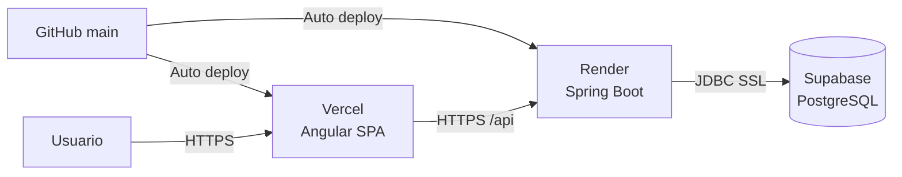
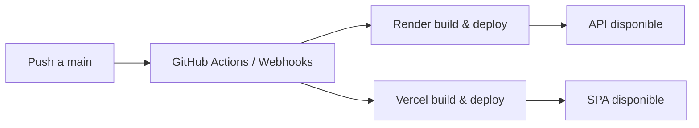

# Despliegue

## 1. Topología de producción



| Componente | Plataforma | Artefacto |
| --- | --- | --- |
| Frontend | Vercel | Build estático de Angular |
| Backend | Render | Contenedor Docker o JAR Spring Boot |
| Base de datos | Supabase | PostgreSQL administrado |

URLs de referencia:

- Frontend: `https://ecosistema-defensas-urbe.vercel.app`
- Backend: `https://ecosistema-defensas-urbe.onrender.com`
- API: `https://ecosistema-defensas-urbe.onrender.com/api`

## 2. Base de datos (Supabase)

1. Crear el proyecto en Supabase.
2. Obtener la cadena de conexión JDBC con SSL.
3. Configurar las credenciales como variables de entorno en Render.
4. Ejecutar los scripts de migración o cargas iniciales necesarias.
5. Crear manualmente los usuarios administrativos con hash BCrypt (ver [seguridad.md](seguridad.md)).

### Consideraciones

- Usar el pooler de Supabase para conexiones desde Render.
- Incluir `sslmode=require` en la URL JDBC.
- En producción, Hibernate usa `ddl-auto=validate`; el esquema debe existir antes de desplegar.
- No versionar cadenas de conexión ni contraseñas.

## 3. Backend en Render

### Configuración del servicio

| Parámetro | Valor |
| --- | --- |
| Repositorio | `joeloco4u/ecosistema-defensas-urbe` |
| Rama | `main` |
| Root Directory | `backend` |
| Runtime | Docker |
| Dockerfile | `backend/Dockerfile` |
| Puerto | `8080` |

El `Dockerfile` compila con Maven 3.9 y Java 17, y ejecuta el JAR con JRE 17.

Alternativa sin Docker:

```bash
mvn clean package -DskipTests
java -jar target/ecosistema-defensas-urbe-1.0.0.jar
```

### Variables de entorno requeridas

| Variable | Descripción | Ejemplo |
| --- | --- | --- |
| `SPRING_PROFILES_ACTIVE` | Perfil de Spring | `prod` |
| `DATABASE_URL` | URL JDBC de Supabase | `jdbc:postgresql://<host>:5432/postgres?sslmode=require` |
| `DATABASE_USER` | Usuario de base de datos | `postgres.<proyecto>` |
| `DATABASE_PASSWORD` | Contraseña de base de datos | *(secreto)* |
| `APP_JWT_SECRET` | Clave Base64 para firmar JWT | *(secreto aleatorio)* |
| `APP_JWT_EXPIRATION_MS` | Vigencia del token en ms | `86400000` |
| `SERVER_PORT` | Puerto HTTP (opcional) | `8080` |

Variables opcionales de negocio:

| Variable | Descripción |
| --- | --- |
| `APP_PERIODO_ACADEMICO_INICIO` | Fecha de inicio del periodo académico |
| `APP_SCHEDULER_CONSUMIR_INSTITUCIONAL` | Expresión cron de la tarea institucional |

### Verificación

```bash
curl -X POST https://ecosistema-defensas-urbe.onrender.com/api/auth/login \
  -H "Content-Type: application/json" \
  -d '{"email":"usuario@urbe.edu.ve","password":"CONTRASENA"}'
```

Respuesta esperada: `200 OK` con `{ "token": "..." }`.

> `/api/ping` está protegido por JWT. Si se configura como health check de Render, usar un chequeo TCP/puerto o habilitar un endpoint de salud público independiente.

## 4. Frontend en Vercel

### Configuración del proyecto

| Parámetro | Valor |
| --- | --- |
| Repositorio | `joeloco4u/ecosistema-defensas-urbe` |
| Rama | `main` |
| Root Directory | `frontend` |
| Framework Preset | Angular |
| Install Command | `npm install` |
| Build Command | `npm run build` |
| Output Directory | `dist/ecosistema-defensas-urbe` |
| Node.js | 18 o 20 |

### URL de la API

La URL se define en `frontend/src/environments/environment.prod.ts`:

```ts
export const environment = {
  production: true,
  apiUrl: 'https://ecosistema-defensas-urbe.onrender.com/api',
};
```

Angular reemplaza `environment.ts` por `environment.prod.ts` durante el build de producción. Cualquier cambio de URL requiere un nuevo despliegue.

Para desarrollo local contra el backend desplegado, `environment.ts` debe apuntar a la misma URL; para backend local, usar `http://localhost:8080/api`.

### SPA routing

Vercel debe redirigir las rutas profundas a `index.html`. Configurar un `vercel.json` en `frontend/`:

```json
{
  "rewrites": [
    { "source": "/(.*)", "destination": "/index.html" }
  ]
}
```

Sin esta regla, rutas como `/dashboard` o `/login` pueden devolver `404` al recargar.

### Variables de entorno

El proyecto no requiere variables de entorno en Vercel; la configuración viaja en los archivos de `environment`. Si en el futuro se parametriza, deben definirse en Vercel y consumirse en tiempo de build.

## 5. CI/CD



### Flujo esperado

1. Se hace merge o push a `main`.
2. Render detecta el cambio, construye la imagen y despliega el backend.
3. Vercel detecta el cambio, ejecuta `npm run build` y publica el frontend.
4. Supabase permanece como servicio administrado; los cambios de esquema se aplican de forma controlada.

### Orden recomendado

1. Base de datos (migraciones o ajustes de esquema).
2. Backend (nuevos endpoints o contratos).
3. Frontend (consumo de los nuevos contratos).

### Verificación posterior al despliegue

- Confirmar que Render responde en `/api/auth/login`.
- Confirmar que Vercel sirve la nueva versión del bundle.
- Probar login, navegación protegida y una operación de lectura.
- Revisar logs de Render y la consola del navegador.

> Si el bundle publicado en Vercel sigue apuntando a una URL antigua, forzar un redeploy desde el panel de Vercel y verificar que el proyecto esté conectado a la rama `main` y al directorio `frontend`.

## 6. CORS y dominios

`CorsConfig` permite:

- `http://localhost:4200`
- `https://*.vercel.app`

Si se usa un dominio personalizado, agregarlo a `allowedOriginPatterns` y redesplegar el backend. El origen del frontend debe coincidir exactamente con el configurado; de lo contrario, el navegador bloqueará la petición antes de llegar al controlador.

## 7. Rollback

- **Frontend:** promover un despliegue anterior desde Vercel.
- **Backend:** redesplegar una imagen o commit anterior desde Render.
- **Base de datos:** restaurar un backup de Supabase o revertir la migración correspondiente.

Antes de revertir, verificar la compatibilidad entre la versión del frontend y el contrato de la API.

## 8. Buenas prácticas

- Gestionar secretos únicamente en Render/Supabase, nunca en Git.
- Rotar `APP_JWT_SECRET` y credenciales de base de datos ante cualquier exposición.
- Mantener `ddl-auto=validate` en producción.
- Supervisar disponibilidad, errores 5xx y latencia.
- Documentar cada cambio de infraestructura en este archivo.
