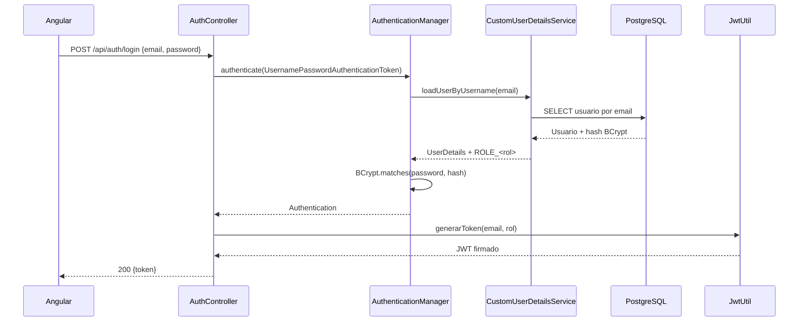

# Seguridad

## 1. Modelo de acceso

El sistema es una aplicación administrativa interna. No existe registro público de usuarios ni flujo de autoalta.

- Solo se expone `POST /api/auth/login` como endpoint público de autenticación.
- El resto de endpoints `/api/**` requieren un JWT válido.
- Los usuarios se crean manualmente en la base de datos.
- El frontend no contiene formularios de registro accesibles ni llamadas a endpoints de signup.
- La administración de usuarios existente está restringida a usuarios con rol `COORDINADOR` mediante `@PreAuthorize`.

## 2. Registro "Zero-UI"

La estrategia **Zero-UI Registration** elimina la superficie de ataque asociada al alta de cuentas:

1. No hay endpoint `/register` ni `/signup`.
2. No hay pantalla pública de creación de cuentas.
3. El primer usuario y los usuarios posteriores se insertan directamente en PostgreSQL.
4. Las contraseñas nunca se almacenan en texto plano: se guardan como hash BCrypt.

### Alta manual de un usuario

#### Paso 1: generar el hash BCrypt

Con Java y Spring Security:

```java
String hash = new BCryptPasswordEncoder().encode("CONTRASENA_TEMPORAL");
```

Con `htpasswd` en sistemas Unix:

```bash
htpasswd -bnBC 10 "" "CONTRASENA_TEMPORAL" | tr -d ':\n'
```

Usar un costo de 10 o superior y no reutilizar contraseñas institucionales.

#### Paso 2: insertar el usuario

La tabla es `public.usuarios`. Columnas relevantes: `id`, `email`, `username`, `password`, `nombre_completo`, `rol`, `activo`, `fecha_creacion`, `fecha_actualizacion`.

```sql
INSERT INTO public.usuarios (
    email,
    username,
    password,
    nombre_completo,
    rol,
    activo,
    fecha_creacion,
    fecha_actualizacion
) VALUES (
    'usuario@urbe.edu.ve',
    'usuario@urbe.edu.ve',
    '$2a$10$HASH_BCRYPT_GENERADO',
    'Nombre Completo',
    'COORDINADOR',
    true,
    now(),
    now()
);
```

Valores de rol previstos por la aplicación: `COORDINADOR` y roles operativos definidos en la base de datos. El rol se expone como autoridad `ROLE_<ROL>`.

#### Paso 3: verificar

```bash
curl -X POST https://<backend>/api/auth/login \
  -H "Content-Type: application/json" \
  -d '{"email":"usuario@urbe.edu.ve","password":"CONTRASENA_TEMPORAL"}'
```

La respuesta debe contener `{ "token": "<jwt>" }`.

### Reglas de higiene

- No versionar correos, hashes ni contraseñas reales.
- No incluir credenciales en seeders, scripts SQL, capturas ni documentación.
- Usar variables de entorno o un gestor de secretos para credenciales de base de datos.
- Rotar cualquier credencial que haya estado expuesta en el repositorio o en el historial de Git.

## 3. Autenticación con Spring Security y JWT

### Dependencias

- `spring-boot-starter-security`
- `jjwt-api`, `jjwt-impl`, `jjwt-jackson` (JJWT 0.12.x)

### Componentes

| Componente | Responsabilidad |
| --- | --- |
| `SecurityConfig` | Cadena de filtros, reglas de autorización, `AuthenticationManager`, `PasswordEncoder` |
| `CustomUserDetailsService` | Carga el usuario por email desde `UsuarioRepository` y construye sus autoridades |
| `JwtUtil` | Genera y valida tokens; extrae sujeto y rol |
| `JwtAuthenticationFilter` | Lee el header `Authorization`, valida el token y llena el `SecurityContext` |
| `AuthController` | Expone `POST /api/auth/login` y devuelve el JWT |
| `CorsConfig` | Define orígenes, métodos y headers permitidos |

### Flujo de login



### Reglas de la cadena de seguridad

- CSRF deshabilitado (API stateless consumida por SPA).
- `SessionCreationPolicy.STATELESS`.
- `OPTIONS /**` permitido para preflight CORS.
- `POST /api/auth/login` permitido sin autenticación.
- `/error` permitido para conservar respuestas de error.
- `/api/**` y cualquier otra ruta requieren autenticación.
- El filtro JWT se ejecuta antes de `UsernamePasswordAuthenticationFilter`.

### Contenido del token

- `sub`: email del usuario.
- `rol`: rol asignado.
- `iat`: fecha de emisión.
- `exp`: expiración (por defecto 24 horas).
- Firma HMAC con una clave secreta codificada en Base64.

La clave y la expiración se configuran con:

```properties
app.jwt.secret=${APP_JWT_SECRET}
app.jwt.expiration-ms=${APP_JWT_EXPIRATION_MS:86400000}
```

En producción, `APP_JWT_SECRET` debe ser un valor aleatorio de alta entropía, distinto del valor de desarrollo, y debe gestionarse fuera del repositorio. Si se rota la clave, todos los tokens emitidos dejan de ser válidos.

### Almacenamiento de contraseñas

- Algoritmo: BCrypt.
- La columna `usuarios.password` tiene longitud 100, suficiente para el hash BCrypt (60 caracteres).
- El backend nunca devuelve la contraseña en las respuestas.

## 4. Seguridad en el frontend

- `AuthService` envía las credenciales a `/api/auth/login` y guarda el token en `localStorage` bajo la clave `auth_token`.
- `authInterceptor` clona cada petición y añade `Authorization: Bearer <token>`.
- Ante un `HttpErrorResponse` con estado `401`, el interceptor elimina el token y redirige a `/login`.
- `AuthGuard` protege todas las rutas funcionales.
- `guestGuard` redirige a `/dashboard` si un usuario ya autenticado intenta abrir `/login`.
- La ruta raíz redirige según el estado de sesión.

### Limitaciones conocidas

`localStorage` es vulnerable ante XSS. Por ello es obligatorio:

- Escapar y sanear cualquier contenido dinámico.
- Mantener Angular y las dependencias actualizadas.
- Aplicar una política CSP estricta en Vercel.
- No incluir scripts de terceros sin revisión.

## 5. CORS

Orígenes permitidos actualmente:

- `http://localhost:4200`
- `https://*.vercel.app`

Métodos: `GET`, `POST`, `PUT`, `DELETE`, `PATCH`, `OPTIONS`.

Si se utiliza un dominio institucional propio, debe añadirse explícitamente a `CorsConfig`. No se debe usar `*` junto con credenciales.

## 6. Recomendaciones operativas

- Forzar HTTPS en frontend, backend y base de datos.
- Limitar intentos de login y aplicar bloqueo temporal o rate limiting.
- Auditar accesos y registrar eventos de autenticación fallida.
- Aplicar el principio de mínimo privilegio al usuario de base de datos del backend.
- Habilitar Row Level Security (RLS) en Supabase si en el futuro se accede a las tablas con claves públicas; definir políticas explícitas antes de hacerlo.
- Revisar periódicamente usuarios activos y roles.
- Eliminar del historial de Git cualquier credencial que haya sido confirmada; rotarla primero.
- Mantener `application-dev.properties` con credenciales locales fuera de Git.
